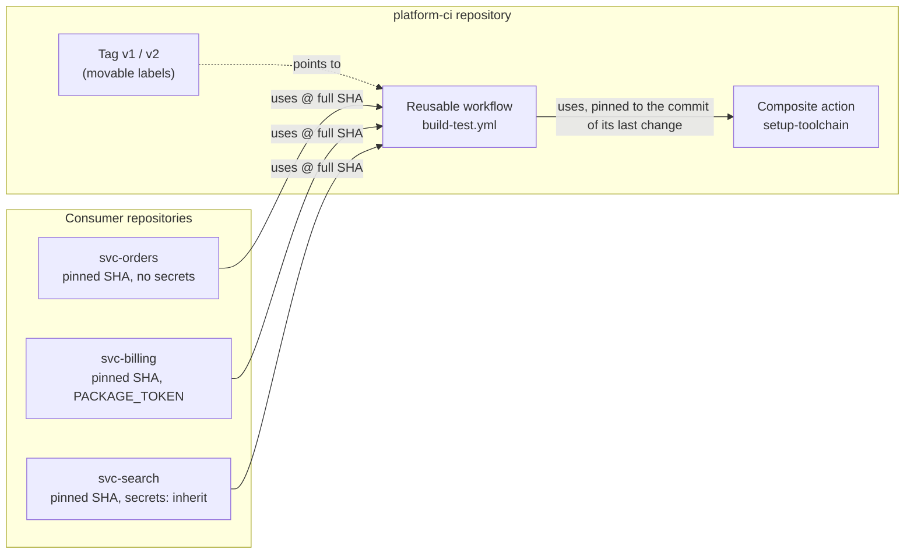

# Architecture: reusable workflows and a composite action

This document describes what is in this repository and why it is shaped this way. Component names match the diagram in the lesson ("Shared CI, and the risk a moving tag carries"): **platform-ci repository** with **Tag v1**, **Reusable workflow** (`build-test.yml`) and **Composite action** (`setup-toolchain`), and the **Consumer repositories** `svc-orders`, `svc-billing` and `svc-search`.

On GitHub the lesson has four repositories. Here the platform is the root of this repository and each consumer is a folder under [`consumers/`](consumers) that is a complete repository on its own (its own `.github/`, `src/`, `tests/` and lock file); publishing a consumer means copying its folder to a repository of that name.

## Components and what each owns

| Component (lesson diagram) | Where it lives | What it owns |
| --- | --- | --- |
| **Reusable workflow** | [`.github/workflows/build-test.yml`](.github/workflows/build-test.yml) | The job every service runs: the runner, `permissions` (`{}` at the top, `contents: read` on the job), the timeout, a checkout without a stored token, the toolchain, a hash-verified install and the test command. Typed inputs (`python`, `test-command`, `working-directory`, `report-secret-names`), one optional secret (`PACKAGE_TOKEN`) and one output (`cache-hit`). |
| **Composite action** | [`.github/actions/setup-toolchain`](.github/actions/setup-toolchain) (own [README](.github/actions/setup-toolchain/README.md)) | Installing a pinned Python and restoring the pip cache keyed on the dependency file. Validates its input first ([`validate-inputs.sh`](.github/actions/setup-toolchain/validate-inputs.sh)). Outputs `cache-hit` and `python-version`. |
| **Tag v1** (and `v2`, `v1.0.0`, `v2.0.0`) | git tags | Labels on release commits. Exact tags never move; `v1` and `v2` are moving major tags. A tag is a label its owner can move; a commit hash cannot be moved. |
| **svc-orders** | [`consumers/svc-orders`](consumers/svc-orders) | A small service; calls the workflow, passes **no secrets**. |
| **svc-billing** | [`consumers/svc-billing`](consumers/svc-billing) | A small service; passes **one named secret** (`PACKAGE_TOKEN`). |
| **svc-search** | [`consumers/svc-search`](consumers/svc-search) | A small service; uses `secrets: inherit`, the form the policy forbids, kept as the example of what it hands over. |
| Reference resolution | [`pipeline/platform_refs.py`](pipeline/platform_refs.py), [`scripts/run_consumer.sh`](scripts/run_consumer.sh) | Resolving `@v1` or a full SHA to a commit the way GitHub does, so a consumer can run locally with `act` against exactly those commits. |
| Pin policy | [`pipeline/pins.py`](pipeline/pins.py), [`.github/workflows/pin-check.yml`](.github/workflows/pin-check.yml), [`allowed-actions.txt`](allowed-actions.txt) | Every `uses:` pinned to a full SHA; the platform's own action pinned to its last change; only allowed actions. |
| Secrets report | [`pipeline/secrets_report.py`](pipeline/secrets_report.py) | What the shared workflow can read, per consumer: none, one named, or everything. |
| Moved-tag demo | [`scripts/demo_moved_tag.sh`](scripts/demo_moved_tag.sh), [`demo/`](demo) | The lesson's step 5, run on a throwaway clone. |
| Organization policy | [`scripts/org-policy.sh`](scripts/org-policy.sh), [`docs/org-ruleset.json`](docs/org-ruleset.json) | The first stretch goal as commands; needs an organization. |

## Pattern: shared code behind a versioned contract

A consumer depends on a contract (the inputs, secrets and outputs of `build-test.yml`) and a ref. Changing the contract
incompatibly is a new major version; the old version stays where it is. The shared code itself is layered: the workflow
decides **what runs and with which rights**; the action decides **how the toolchain is prepared**; scripts hold any logic
that is more than one command and are unit-tested. The consumers are ordinary layered services (domain, application,
infrastructure, interfaces) whose only CI is a call to the shared workflow.

## Data flow

Drawn versions of this figure and of the walk-through: [the architecture](docs/diagrams/architecture.svg) and [one run](docs/diagrams/flow.svg).

### One run, step by step (a push to `svc-billing`)

1. The push triggers `svc-billing/.github/workflows/ci.yml`, ten lines long. Its one job has `uses: sumitsr/platform-ci/.github/workflows/build-test.yml@fcd73fa... # v2.0.0`, `with: { python: "3.12" }` and `secrets: { PACKAGE_TOKEN: ... }`.
2. GitHub resolves the ref to a commit. A full SHA resolves to itself; `@v2` would resolve to wherever the tag points today.
3. The called workflow runs in `svc-billing`'s context with the permissions the caller allowed (`contents: read`) capped by its own (`{}` at the top, `contents: read` on the job). It receives `PACKAGE_TOKEN` and no other secret.
4. `actions/checkout` checks out `svc-billing`; `persist-credentials: false` keeps the token out of `.git/config`.
5. The `setup-toolchain` action runs from the commit named in the workflow. It validates `python`, installs it, and restores the pip cache under the key `pip-<OS>-<exact Python>-<hash of requirements.txt>`; `cache-hit` is `true` on the second run.
6. `pip install --require-hashes -r requirements.txt` installs the hashed lock file; `PACKAGE_TOKEN` is in that step's environment for a private index.
7. The test command arrives through an environment variable (`TEST_COMMAND`) and runs with `bash -c`, so the expression is never pasted into script text.

## Decisions and trade-offs

**A reusable workflow and a composite action** ([ADR 0001](docs/adr/0001-a-reusable-workflow-and-a-composite-action.md)): the first owns a job and its rights, the second a bundle of steps.

**The platform's own action is pinned to the commit of its last change** ([ADR 0002](docs/adr/0002-pin-the-platforms-own-action-to-the-commit-of-its-last-change.md)), so a moving tag in the middle of the shared code cannot undo the consumers' pins, and `make lint` fails if the pin goes stale.

**Consumers pin by commit, majors are moving tags, secrets cross by name** ([ADR 0003](docs/adr/0003-consumers-pin-by-commit-majors-are-moving-tags-secrets-by-name.md)).

**Breaking change = new major, old tag untouched.** `v2` renamed `python-version` to `python`. A consumer still on `v1` or on the commit of `v1.0.0` runs exactly as before (`make run-all` runs consumers on both). The CHANGELOG states per release what each consumer must change, and a test fails when a release has no such section.

**`working-directory` input.** Lets the platform test the workflow on each consumer folder in this one repository (`ci.yml`, job `consumers`), and lets monorepos use it. A standalone consumer leaves it at `.`.

**Test command through `env` and `bash -c`.** The caller's string is still run (that is its purpose), but never spliced into the script by the expression engine.

**`report-secret-names` is off by default.** The runtime proof of "what can the called workflow read" puts `toJSON(secrets)` into a step's environment, which is itself the thing a policy might not want in shared code; the static `make secrets-report` gives the same table without it.

## Failure modes the lesson teaches, and how to reproduce each

| Failure | What you see | How to reproduce |
| --- | --- | --- |
| **Missing `shell:` in a composite step** | The workflow fails to load: "Required property is missing: shell". | `tests/test_setup_toolchain_action.py` asserts every `run` step names its shell. |
| **`./actions/...` inside the reusable workflow** | The path is resolved in the caller's workspace, where the action does not exist. | ADR 0001; the workflow uses the repository path. |
| **`secrets: inherit` everywhere** | The shared workflow can read every secret of every caller. | `make secrets-report` prints `svc-search  inherit  every secret in svc-search`. |
| **A breaking change without a new major** | Consumers on the old tag fail on their next run. | Rename an input on `v1`'s commit; `tests/test_build_test_workflow.py` and the CHANGELOG check guard the release. |
| **A moved tag** | The consumer on `@v1` runs code it never reviewed; the one on a SHA does not. | `make demo-moved-tag`. |
| **A stale pin to the action** | The workflow runs an older action than the one in the tree. | Edit `action.yml`, commit, run `make lint`: "stale internal pin". |
| **A pin from a fork or the wrong repository** | The SHA exists but is not the reviewed code. | `pipeline/pins.py` checks the repository name against `allowed-actions.txt`. |

## Limits of the teaching build against production

- The platform and consumers share one git history here. In the lesson they are four repositories; the pinned SHAs of the platform are commits of this history, which is why the repository must be published as `sumitsr/platform-ci` with its history intact.
- `act` resolves remote workflow references through `--local-repository` (`scripts/run_consumer.sh` supplies it from git); it does not model GitHub's permission capping, secrets or the cache service exactly. The runtime facts that need GitHub (the cache hit on the second run, the "Waiting" state of required workflows) are in the README's list of things to confirm after the first push.
- The organization policy script and ruleset are written to the API's documented shape and have not been run (no organization).
- No JavaScript version of the action (second stretch), which would add a build step and a `dist/` to review.

## How to extend it

- **A new input:** add it to `workflow_call.inputs` with a type and a default so it is a minor release; a required input or a rename is a new major. Add a line to the CHANGELOG with the instruction.
- **A new release:** commit the change, tag `vX.Y.Z` (annotated), move the major tag (`git tag -f -a vX`), update the CHANGELOG, then let the bot open the pin updates in the consumers.
- **A change to the action:** commit it alone, then commit the workflow with the new pin (`make lint` prints the commit it expects).
- **Another consumer:** copy a folder under `consumers/`, keep its workflow under fifteen lines, add it to the matrix in `ci.yml` and to `make test`.
