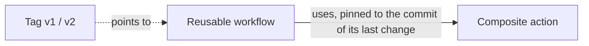

# Markdown and Mermaid

## What it is

Markdown is a plain-text way to write formatted documents: `#` for headings, `-` for bullets, backticks for code, `|` for tables. GitHub shows `.md` files as formatted pages. Mermaid is a text language for diagrams; GitHub draws a code block marked `mermaid` as a picture.

## Why this repository uses it

The task requires a detailed README, an architecture document with a diagram, decision records, a changelog that tells every consumer what to change, and this `tech/` folder. Plain text in the repository is reviewed in pull requests like code. A test even reads `CHANGELOG.md` and fails when a release has no "Required changes for consumers" section.

## Where it appears

| Path | What it does with Markdown |
| --- | --- |
| `README.md`, `ARCHITECTURE.md`, `CHANGELOG.md` | The documents. |
| `.github/actions/setup-toolchain/README.md` | The action's own documentation. |
| `docs/adr/*.md` | Three decision records. |
| `consumers/*/README.md` | One short README per consumer. |
| `ARCHITECTURE.md` | A fenced `mermaid` block with the data-flow diagram. |
| `tests/test_build_test_workflow.py` | Reads `CHANGELOG.md` with regular expressions. |
| `tech/*.md` | These notes. |

## How it works underneath

A Markdown file is just text. A renderer (GitHub's page, an editor preview) reads it line by line and turns the marks into formatting. Tables use `|` between cells and a second line of dashes; `---:` right-aligns a column. A fenced code block starts and ends with three backticks and can name a language after the opening fence. Mermaid is drawn in the reader's browser from the text in the block.

## Walkthrough of this repository's use

### A changelog the tests read

```text

## [2.0.0] - 2026-10-27

### Changed (breaking)
...
### Required changes for consumers

In the job that calls the workflow, rename the key under `with:`:
```

Each release is a `## [X.Y.Z]` heading with a `### Required changes for consumers` section that says in plain words what a consumer must edit. The test:

```python
releases = re.findall(r"^## \[(\d+\.\d+\.\d+)\]", text, flags=re.M)
sections = re.split(r"^## \[", text, flags=re.M)[1:]
assert releases == ["2.0.0", "1.0.0"]
for section in sections:
    assert "### Required changes for consumers" in section
```

`re.findall` collects the version numbers from the headings; `re.M` makes `^` match at the start of every line; `re.split` cuts the file into one piece per release. Adding a release without that section fails the test.

### A diagram

````text

````

`flowchart LR` is a left-to-right flow chart. `["text"]` is a box; `-->` an arrow; `-. "label" .->` a dotted arrow; `subgraph ... end` groups boxes (the platform repository, the consumers). The names mirror the lesson's diagram.

## Try it yourself

1. Open `ARCHITECTURE.md` on GitHub (or in an editor with Mermaid preview) to see the diagram.
2. `grep -n '^## \[' CHANGELOG.md` prints the two release headings, `2.0.0` and `1.0.0`.
3. `.venv/bin/python -m pytest tests/test_build_test_workflow.py -k changelog -q` runs the changelog test.

## Mistakes people make

- A table row with a different number of cells than the header.
- Forgetting the blank line before a list or table, so it is shown as plain text.
- A code fence that is never closed, which swallows the rest of the page.
- Quotes inside Mermaid labels without quoting the label.

## Check yourself

1. How does GitHub draw a diagram from text? *(A `mermaid` fenced block is rendered by Mermaid.)*
2. What does `---:` do in a table? *(Right-aligns the column.)*
3. What does the changelog test check? *(That every release heading has a "Required changes for consumers" section.)*
4. What does `re.M` change? *(`^` and `$` match at each line, not only at the ends of the text.)*
5. What starts and ends a code block? *(Three backticks.)*

## Further reading

- GitHub Flavored Markdown spec: https://github.github.com/gfm/
- Mermaid flowcharts: https://mermaid.js.org/syntax/flowchart.html
